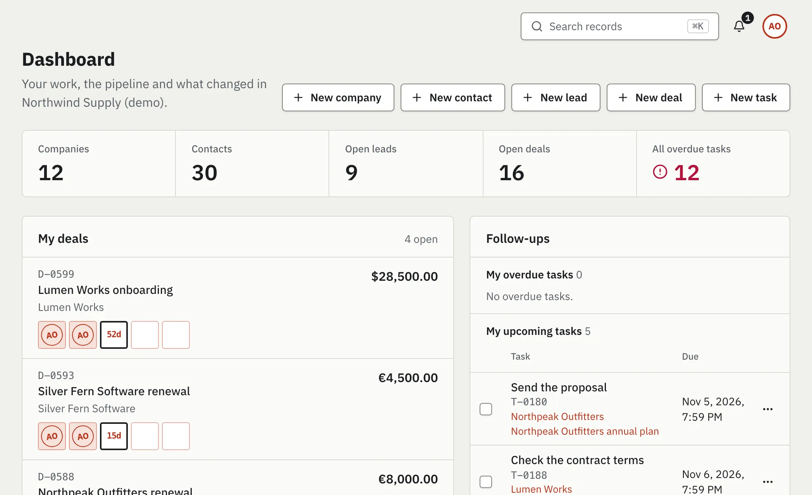
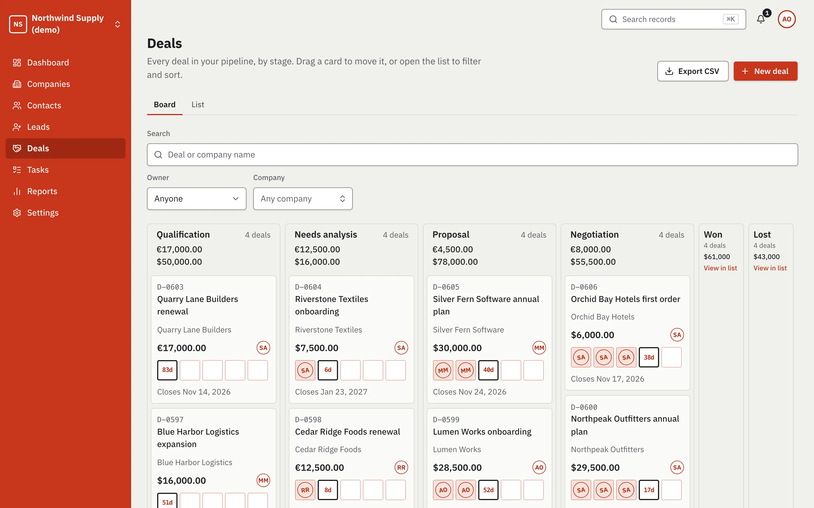
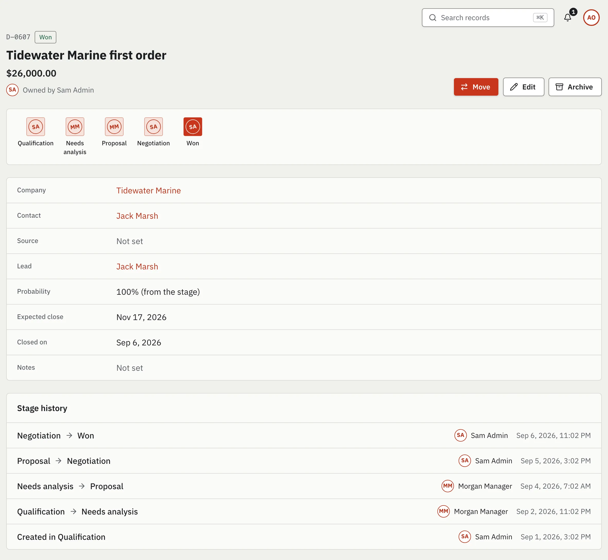
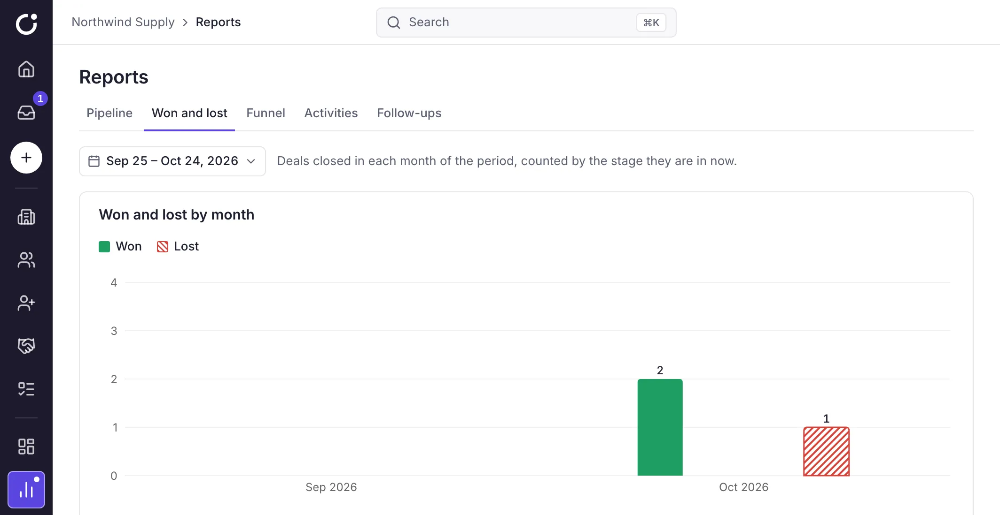
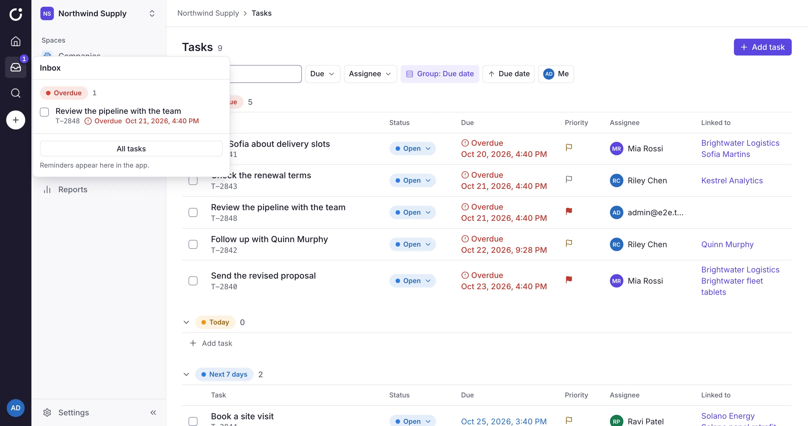
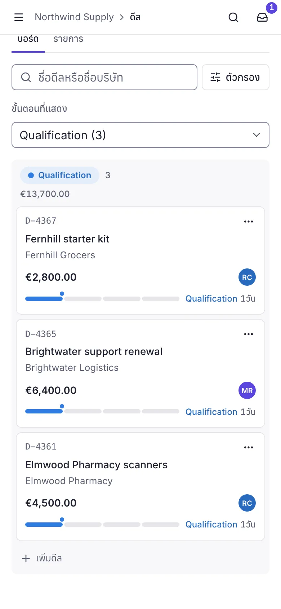

# Aureon CRM web

The web app of **Aureon CRM**, a multi-user CRM for small and medium-sized businesses, on
**Next.js 16** (App Router, React 19, TypeScript, Tailwind v4, shadcn/ui, next-intl). Every
business is a workspace; people join one through an invitation link and get a role in it (owner,
admin, manager or sales rep). It has companies and contacts, leads that convert into a contact and a
deal, a drag-and-drop pipeline whose stamp row shows who moved each deal, tasks with in-app
reminders, activities, a record search, a dashboard and five reports, CSV export and an audit
trail, in English, French and Thai, in light and dark themes. How to use it:
[the user guide](docs/user-guide.md).

Its backend is [aureon-crm-api](https://github.com/neszaDev/aureon-crm-api) (Spring Boot and
PostgreSQL). The CRM's specification, data model, permission matrix and REST contract live there,
in [`docs/crm/`](https://github.com/neszaDev/aureon-crm-api/tree/feat/crm/docs/crm) (on its
`feat/crm` branch, like this app's CRM, until both are merged). Only the Next.js
server talks to it: the browser never sees a token (they stay in httpOnly cookies), and the API
types are generated from its OpenAPI spec.

The repo was split from [nextjs-boilerplate](https://github.com/neszaDev/nextjs-boilerplate),
itself based on [Next.js Boilerplate](https://github.com/ixartz/Next-js-Boilerplate) by ixartz
(MIT). The boilerplate's demo pages stay at `/dashboard/**` as a component gallery.

## Screens

Real captures of the running app, on the API's demo data (from `public/landing/`, where the
landing page shows them; see its README for how they are made):

| Dashboard | Deals board |
|---|---|
|  |  |
| **A won deal: its stamp row and stage history** | **Reports** |
|  |  |
| **My tasks, with the reminders open** | **On a phone, in Thai** |
|  |  |

## Prerequisites

- **Node.js 24+** and **pnpm** (`corepack enable` picks the pinned version)
- **Docker**, and a checkout of [aureon-crm-api](https://github.com/neszaDev/aureon-crm-api) to
  run the backend (its `make up` builds and runs it in Docker; no Java needed)
- `make`

## Quick start

1. The API, in a checkout of aureon-crm-api on its `feat/crm` branch:

   ```sh
   make setup   # creates its env/.env: set JWT_SECRET and APP_PORT=8081 there (for the
                # end-to-end tests also the admin and rate limits in docs/testing.md here)
   make up      # Postgres + the API on http://localhost:8081
   ```

2. The app, here:

   ```sh
   make setup   # pnpm install (+ git hooks), Playwright browser, env/.env:
                # set BACKEND_URL=http://localhost:8081 there
   pnpm dev     # the app on http://localhost:3000
   ```

Sign up at `/sign-up` and create your first workspace.

### Demo data

To look around a populated CRM, start the API with `DEMO_DATA=true` in its `env/.env` (local and
dev profiles only). It seeds, once, a fictional workspace **Northwind Supply (demo)** (USD,
Asia/Bangkok) with companies, contacts, leads in every status, deals in every stage with months of
history, tasks and activities, and four members, one per role. Their logins and the password are in
the API's [`docs/crm/README.md`](https://github.com/neszaDev/aureon-crm-api/blob/feat/crm/docs/crm/README.md#try-it)
(owner, admin, manager and sales rep, so each role can be tried). The tests never use it: each
one makes its own accounts and workspace.

The end-to-end tests run against the same API, one worker at a time:

```sh
pnpm exec playwright test --project=chromium --workers=1
```

`make backend-up`, `make e2e` and `make up` here start the API from a published image, which
doesn't exist yet (see [configuration](docs/configuration.md#local-docker-stack-envenv)).

## Commands

| Command | What it does |
|---|---|
| `make fmt` | Format and auto-fix lint issues |
| `make lint` | Lint, type check, unused code/deps (knip), i18n keys |
| `make test` | Unit + UI component tests |
| `make verify` | Lint, unit + UI tests and the production build, as in CI |
| `make e2e` | Playwright against `pnpm dev` + the backend container |
| `make e2e-image` | Playwright against the production image, as CI does |
| `make api-types` | Regenerate API types from the backend's OpenAPI spec |
| `make up` / `make down` | Full stack in containers / stop it |

Run `make` to list them all. Against the API repo on 8081, regenerate the types with
`BACKEND_URL=http://localhost:8081 pnpm api:types`.

## Project layout

```
src/app/[locale]/   pages: (marketing) public, (auth) sign-in/up, invite links, app/** (the CRM)
                    and dashboard/** (the boilerplate's demos)
src/app/api/crm/    the CSV export route (streams a list's file from the backend)
src/components/crm/ the CRM: shell/ (rail, switcher, search, reminders bell, account menu),
                    dashboard/, reports/, audit/, settings/, a folder per record, the list kit
src/actions/        server actions (auth; crm/: every CRM write, and the reads client components need)
src/libs/api/       typed backend client, read queries (CrmQueries.ts), error mapping, schema
src/libs/crm/       CRM logic: permissions, list and period URLs, formatting, time zones
src/proxy.ts        i18n routing + auth (protects /app and /dashboard, refreshes tokens)
public/landing/     the landing page's captures of the app
tests/e2e/          Playwright, always against the real backend (crm/: the CRM flows and the journey)
docker/  env/  scripts/  docs/  .github/   same roles as in the API repo
```

## Pulling boilerplate updates

The boilerplate stays a remote, so its fixes (dependency advisories, auth, CI) can be merged in:

```sh
git remote add boilerplate https://github.com/neszaDev/nextjs-boilerplate.git   # once
git fetch boilerplate
git switch -c chore/boilerplate-sync dev
git merge boilerplate/dev        # resolve conflicts, keeping the CRM's names and copy
```

Then run `make verify` and the end-to-end tests, and open a PR into `dev`.

## Documentation

| Guide | Covers |
|---|---|
| [User guide](docs/user-guide.md) | The CRM's workflows, and who may do what |
| [Architecture](docs/architecture.md) | Request flow, auth/session design, the CRM's routes and shell, where code goes |
| [Backend integration](docs/backend-integration.md) | Typed client, regenerating types, errors, adding an endpoint |
| [Configuration](docs/configuration.md) | Every environment variable |
| [Testing](docs/testing.md) | Unit, UI and end-to-end tests, and running the CRM specs locally |
| [CI/CD](docs/ci.md) | Branches, workflows, image publishing, releasing |
| [Contributing](.github/CONTRIBUTING.md) | Branches, commits, PR checklist |
| [AGENTS.md](AGENTS.md) | Rules for AI coding agents (also a good checklist for humans) |
| [PRODUCT.md](PRODUCT.md) · [DESIGN.md](DESIGN.md) | Who the CRM is for, and its design system |
| [CRM status](https://github.com/neszaDev/aureon-crm-api/blob/feat/crm/docs/crm/status.md) (API repo) | Feature matrix with the tests behind each row, known limitations, follow-ups |
| [CRM security](https://github.com/neszaDev/aureon-crm-api/blob/feat/crm/docs/crm/security.md) (API repo) | Security and authorization model, what was verified and what wasn't, Phase 4 findings |
| [Production checklist](https://github.com/neszaDev/aureon-crm-api/blob/feat/crm/docs/crm/production-checklist.md) (API repo) | Both services, the reverse proxy and TLS, before going live |
| [CRM plan](docs/plans/0004-crm.md) | How the CRM frontend is built, slice by slice |
| [Setup plan](docs/plans/0001-frontend-setup.md) | Why the repo is set up this way |

## Deploying

Nothing is deployed yet: the project runs locally only, and the CI/CD workflows that would publish
the image to `ghcr.io/neszadev/aureon-crm-web` (`:dev` from `dev`, `:latest` / `:1.2.3` from `main`
and tags after approval) are disabled ([CI/CD](docs/ci.md)). Before going live, work through the
API repo's
[production checklist](https://github.com/neszaDev/aureon-crm-api/blob/feat/crm/docs/crm/production-checklist.md)
and read its
[security notes](https://github.com/neszaDev/aureon-crm-api/blob/feat/crm/docs/crm/security.md).

Run it with `BACKEND_URL` (where the server reaches the API) and `APP_URL` (its public URL;
`https://` makes cookies `Secure`), behind a TLS terminator that sends `Strict-Transport-Security`
(the app sends its other security headers itself, but not HSTS: one image runs under any
`APP_URL`). Never expose it directly: the reverse proxy in front must make the client's address the
last `X-Forwarded-For` entry (nginx: `proxy_set_header X-Forwarded-For $remote_addr;`), or a client
picks its own and the per-IP sign-in and registration limits don't hold, and must pass the
browser's `Host` on (`proxy_set_header Host $host;`, or `$http_host` when the public URL carries a
port), or every server action fails ([configuration](docs/configuration.md)). It must also cap
request bodies at 11 MB on the files page (`/dashboard/files`) and 1 MB everywhere else: Next reads
up to 11 MB of a POST before its own 413 ([request bodies](docs/architecture.md#request-bodies)).
Keep the logs clean of secrets: an invitation's path (`/invite/<token>`) is one, which the app keeps
out of its own request log and a reverse proxy's access log must drop too, and
`NEXT_PUBLIC_LOGGING_LEVEL` stays at `info` or above (it is inlined at build).
