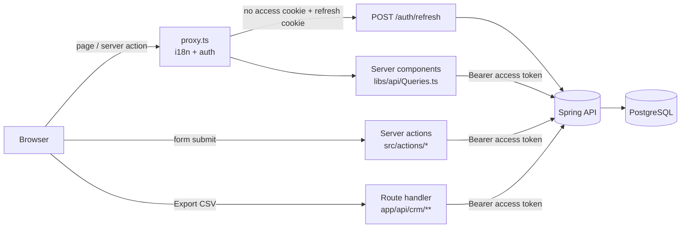

# Architecture

## Request flow

The browser never talks to the backend and never sees a token. Everything goes through the
Next.js server, which holds the session in two **httpOnly** cookies.

## Session design

| Cookie | Holds | Lifetime |
|---|---|---|
| `access_token` | backend JWT (15 min by default) | token lifetime − 30 s |
| `refresh_token` | backend refresh token (rotates on use) | refresh-token lifetime |

- **Sign-in/sign-up** (`src/actions/AuthActions.ts`, and sign-up through an invitation in
  `src/actions/crm/InvitationAcceptActions.ts`) call the backend, set both cookies
  (`startSession` in `src/libs/api/Session.ts`) and go to `/app`, or to the page's `?next=` when
  `safeNextPath` (`src/libs/SafeRedirect.ts`) accepts it (only `/app/**` and `/invite/**`; this
  is what keeps it from being an open redirect).
- **Protected pages** (`/app/**` and `/dashboard/**`, any locale) go through `src/proxy.ts`.
  With no access cookie but a refresh cookie, it calls `/auth/refresh`, sets the new cookies on
  the request (so this render already uses them) and on the response (so the browser keeps
  them). With neither, it redirects to `/sign-in`, with `?next=` back to the page for `/app/**`.
- **The CSV export** (`/api/crm/<workspace>/export/<list>`, a route handler the list's Export
  button fetches) goes through the proxy too, which refreshes the session the same way but never
  redirects: the route streams the backend's file through, or answers JSON `{ message }`
  (translated by code), or a bare 401 with the cookies cleared, as an action would, which the
  button turns into the sign-in page.
- **Invitation pages** (`/invite/<token>`) are public. The proxy refreshes the session there too,
  but never redirects, so a signed-in visitor is still recognised. The token is a secret: the
  page sends no `Referer` (meta and header), and nothing logs it (`redactPath` in `ApiError.ts`;
  `next.config.ts` keeps invite URLs and Server Function arguments out of the dev log).
  Without email delivery, whoever holds a link (the inviter included) can register the invited
  email: share links privately and revoke unused ones.
- Because each cookie expires with its token, "is the access cookie present?" is the only check
  needed: no JWT decoding in the frontend.
- **Requests that refresh together share one refresh.** Two tabs, the bell, a prefetch and an
  export can arrive at once with the same expired session: the proxy calls `/auth/refresh` once
  and gives every one of them the same new cookies, instead of each but the first losing the
  rotation and bouncing through `/sign-in?expired=1`. A failed refresh is shared only by the
  requests already waiting on it; the next one asks the backend again. A successful one is kept
  for 2 s, so for 2 s after a rotation, a request carrying the old refresh token to the same
  server process receives the new pair (the API's own reuse grace would answer 401); this narrow
  window is the price of not bouncing concurrent tabs. The map behind it lives in the server
  process (keyed by the token's hash, at most 1,000 at once), so this holds per process: with
  several instances, a request on another one still loses, and relies on the API's 30 s reuse
  grace, which refuses it without revoking the session (the browser keeps the winner's cookies).
- **A failed refresh does not delete cookies.** Two tabs can refresh at once and, with rotation,
  the second one loses; deleting would sign out the tab that just succeeded.
- **Sign-out** revokes the refresh token on the backend (best effort) and clears both cookies.
- A backend **401** anywhere else (e.g. a deleted account) ends the session: pages and layouts
  redirect to `/api/session/expired` (outside the proxy), which deletes both cookies and goes to
  `/sign-in?expired=1` with a notice; server actions delete them themselves. Sending the user
  straight to `/sign-in` would loop, since the proxy still sees the access cookie. This is not
  the refresh race above: the backend's 401 is final. Another site can't sign anyone out by
  linking there: a request the browser marks `Sec-Fetch-Site: cross-site` or `same-site` (a
  sibling subdomain) ends the session only when the backend refuses its access token
  (`/users/me`), and otherwise goes on to `/app` with the cookies untouched. It still ends a refused one, since a visitor who followed another site's link
  to a page keeps that mark through the redirects here.
- Cookies are `Secure` when `APP_URL` is `https://`.

## Where code goes

| Need | Put it in |
|---|---|
| A page | `src/app/[locale]/(marketing)` (public), `(auth)/app/[workspaceId]` (the CRM) or `(auth)/dashboard` (demos) |
| Read data for a page | a function in `src/libs/api/Queries.ts` (CRM: `CrmQueries.ts`) |
| Change data | a server action in `src/actions/` (validate with zod, map errors, revalidate) |
| Validation rules | `src/validations/`, mirroring the backend's request constraints |
| Text | `src/locales/en.json` **and** every other locale |
| Env var | `src/libs/Env.ts` + [configuration.md](configuration.md) + `env/.env.example` |

## The CRM: routes and shell

Every CRM route sits under `src/app/[locale]/(auth)/` and works in every locale (`/fr/app/...`).

| Route | What it is |
|---|---|
| `/app` | The signed-in home: the create form with no workspace, the workspace itself with one, the list with several (`PickerFrame`: wordmark and your seal over one column) |
| `/app/new` | Create another workspace |
| `/app/{workspaceId}` | The dashboard (`?from&to`: the period of its won and lost); an empty workspace starts with its first records |
| `/app/{workspaceId}/settings/{workspace,members,roles,pipeline,sources,audit,profile}` | Settings: name, currency and time zone; members and invitation links; the role matrix; pipeline stages; lead sources; the audit trail (`?entityType&actorId&page`, owners and admins); your display name and password |
| `/app/{workspaceId}/companies`, `/contacts`, `/leads`, `/deals` | The record lists (deals: `?view=list`; the default is the board). Each has `/new`, `/{id}` (the record page) and `/{id}/edit` |
| `/app/{workspaceId}/tasks`, `/tasks/{id}` | Tasks: the list with its views (mine, overdue, next 7 days, completed, all) and a task's page |
| `/app/{workspaceId}/reports` | The reports, one tab at a time (`?tab=pipeline\|won-lost\|funnel\|activities\|follow-ups&from&to`) |
| `/api/crm/{workspaceId}/export/{list}` | Route handler: the CSV of a list (companies, contacts, leads, deals) for its page's filters, streamed from the backend |
| `/`, `/about` | Public: the landing page (real captures of the app in `public/landing/`) and About, static per locale |
| `/invite/{token}` | Public: an invitation's preview, then register, sign in or join (`(center)` layout, like sign-in and sign-up) |

- `app/layout.tsx` loads the signed-in user; a 401 ends the session (`/api/session/expired`), a
  5xx throws to the error boundary.
- `app/[workspaceId]/layout.tsx` loads the workspace (`GET /workspaces/{id}`, with the caller's
  role and `permissions`) and the caller's workspaces, then renders `CrmShell`: the vermilion
  seal rail (workspace switcher, sections from `CrmNav`) on large screens, a vermilion bar that
  opens the rail as a drawer below `lg`, your seal for the account menu (profile, theme,
  language, the demo gallery, sign out) and a skip link. A 404 (unknown workspace, or not a
  member) is `notFound()`, "Workspace not found"; a 403 shows `ForbiddenNotice`.
- Pages read the same cached calls (`CrmQueries.ts`), hide what `can(workspace, permission)`
  (`src/libs/crm/Permissions.ts`) says the caller can't do, and still handle the backend's 403.
- Writes are server actions in `src/actions/crm/`, bound to the workspace id. Record edits send
  the `version` they read; a stale one (409) is "Someone else changed this", with a reload.

### Record pages

- **Lists** keep their whole state in the URL (`?q&page&size&sort&direction&<filters>`, parsed by
  `src/libs/crm/ListQuery.ts`), so every view is linkable and rendered on the server. A value the
  list can't use (`?page=-1&sort=DROP`) falls back to its default; a query the backend still
  refuses (a search over 200 characters) shows `InvalidFilterNotice` with a link that resets the
  list, never an error page. The list kit is `src/components/crm/list/` (search, sort headers,
  filters, pager, empty states).
- **A record's page** is `RecordHeader` (mono record number `C/P/L/D/T` + 4 digits, name, owner's
  seal, actions the caller may take), the record's facts, and `RecordWork`: its tasks and its
  activity timeline (a company's holds its contacts' and deals' too). A record that 404s is
  `RecordNotFound` inside the shell; only a lost workspace is "Workspace not found".
- **Leads** move New, Contacted, Qualified (or Unqualified with a reason) from a status menu and
  convert in a dialog into a company, a contact and a deal; a repeated conversion returns the
  first result (`alreadyConverted`), so a double click makes one deal.
- **Deals** are a board and a list. The board (`DealBoard`, dnd-kit) moves a card by pointer or
  keyboard, or from "Move to…"; only the people who may move the deal (its owner, or
  `RECORDS_EDIT_ANY`) get the handle and the menu. A drop outside every column cancels; a drop on
  Lost asks for the reason first. A refused move puts the card back and says why in a toast. A
  deal's page shows the stamp row (`StampRow`: each reached stage signed by whoever moved the
  deal into it) and the stage history.

### Insights

- **The dashboard and the reports** read the API's figures through `CrmQueries.ts` and show them as
  they are: no re-aggregation on the page, never a sum across currencies, each period labelled from
  the `period` the response names. The period lives in the URL (`?from&to`); `PeriodQuery.ts`
  keeps only real days, `from` ≤ `to`, at most 366 days apart, and drops anything else for the
  API's default (the last 30 days in the workspace's time zone). Every chart (recharts, through
  `components/ui/chart.tsx`, colours `--chart-1..5`, never colour alone) has its data in a table.
- **Record search** (`RecordSearch`, ⌘K) and **the reminders bell** live in the shell's top bar.
  The search asks the four lists (`q`, 5 each) through a server action; the bell's count comes from
  `GET /reminders`, read by the workspace layout and again by the bell on every navigation.
  Reminders are in-app only.
- **The CSV export** is the one route handler that talks to the backend: the list's Export button
  fetches it with the page's filters and saves the file once all of it has arrived, under the
  backend's name. It refuses `HEAD` and a request the browser marks cross-site (a link on another
  site would otherwise export, and audit, in the user's name). Only roles with `EXPORT` see it.
- **The audit trail** is a settings page for `AUDIT_READ`; every record's page has its own
  History (`RecordHistory`), readable by every member.

## Rendering

Public pages are statically generated per locale. Everything under `app` and
`dashboard` is `force-dynamic`: personal data is never prerendered or cached.

## Deployment shape

`docker/Dockerfile` builds Next's standalone server (non-root, `node server.js`). The same image
runs in every environment; `BACKEND_URL` and `APP_URL` are read at startup, not baked in.
